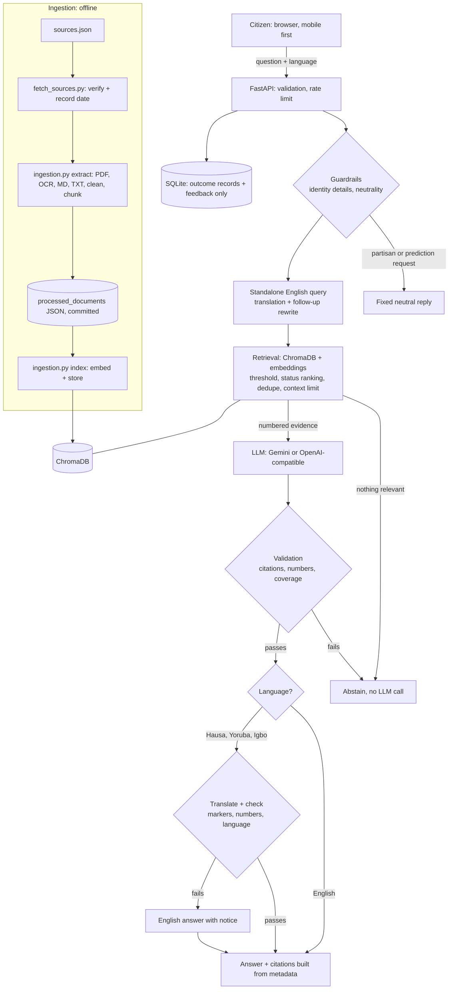

# Architecture

CivicBridge AI is a React frontend and a FastAPI backend. The backend runs a custom RAG pipeline over ChromaDB. A custom pipeline was chosen over LlamaIndex because the most important logic (citation validation, status-aware ranking, abstention and translation checks) is project-specific and easier to test and explain as plain code.

## Decisions and why

| Decision | Why |
|---|---|
| The LLM cites by number; the code builds citations | An invented citation has nothing to resolve to, so it can't reach a user |
| Answer in English, then translate and check | Grounding can be validated in one language, and failed translations can fall back honestly |
| Numbers in an answer must appear in its cited evidence | Catches invented fines, dates and deadlines, where errors do most harm |
| Each document has a status | Live does not mean current: INEC's own FAQ cites the repealed 2022 Act |
| Time-critical notices are always added for relevant topics | "Registration has ended" must outrank an older how-to guide |
| Query expansion for terms such as PVC | Citizens say "PVC"; the law says "voter's card" |
| Two-stage ingestion, committing processed JSON | Deploys need neither OCR nor INEC's site to be up |
| ONNX in production, Sentence Transformers in development | Same model and matching vectors, with about half the memory |
| In-memory sessions and rate limits | No personal data on disk. The cost: this assumes one server process |

## Structure changes from the original brief

Added: `knowledge_base/sources.json` and `fetch_sources.py` (curated, verified sources), `backend/app/services/guardrails.py`, `citations.py` and `prompts.py` (separately testable safety logic), `docs/api.md`, `docs/hackathon_kit.md`, `backend/tests/`, and `render.yaml`.
